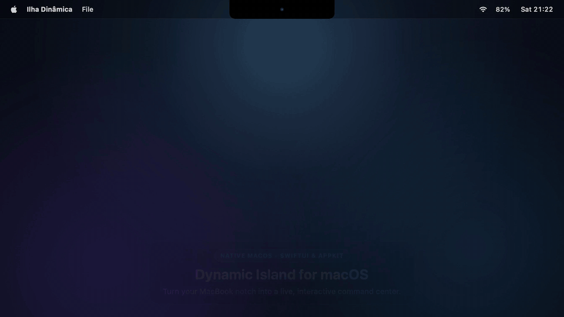

# Ilha Dinâmica

Native **Dynamic Island** for macOS engineered with **SwiftUI** and **AppKit**, seamlessly anchored around your MacBook notch (or floating cleanly on non-notched displays).


> Every genuinely good Dynamic Island app for macOS was paid — so I built my own and open-sourced it.

[](media/ilha-dinamica-demo-en.mp4)

<p align="center">
  <a href="media/ilha-dinamica-demo-en.mp4">▶ Watch full 1080p @ 60fps MP4 demo</a>
</p>

---

## Key Features

### 1. Universal Media Player (Desktop Apps, YouTube & Streaming Platforms)
- **Desktop Players:** Full native AppleScript integration for **Spotify**, **Apple Music**, **Apple TV**, **VLC**, and **QuickTime Player** (artwork extraction, adaptive accent color sampling, real-time scrub bar, and `±10s` skip controls).
- **YouTube & Web Platforms:** Detects active media across **Google Chrome**, **Chrome Canary**, **Arc**, **Brave**, **Microsoft Edge**, **Opera**, **Vivaldi**, **Safari**, and **Safari Technology Preview** using public **CoreAudio** process telemetry (`kAudioHardwarePropertyProcessObjectList`) paired with targeted tab inspection and public **oEmbed** metadata (`i.ytimg.com` thumbnails + channel names) for **YouTube**, **YouTube Music**, **Netflix**, **Twitch**, **Prime Video**, **Disney+**, **Max**, **Globoplay**, **Crunchyroll**, **SoundCloud**, **Deezer**, **Tidal**, and **Vimeo**.
- **Any Other Audio Source:** Automatically falls back to the running app's name, app icon, and HID system media keys (`Play/Pause`, `Next`, `Previous`) for Firefox, IINA, Podcasts, and any audio-producing app.

### 2. Instant Temporary Hide (`⌃⌥H`)
- Press **`Control + Option + H`** globally at any time — or use the Menu Bar icon (`eye.slash`) or expanded header button — to temporarily hide the island when clicking top-bar menus beneath the notch.
- Supports **timed auto-resume** (`1 minute`, `5 minutes`, `15 minutes`, `1 hour`) or manual restore, automatically suppressing hover expansion, toasts, and drag triggers until revealed.

### 3. 9 Customizable Layout Presets & 3-Channel Color Engine
- Switch in one click between **DynamicLake**, **Atoll**, **SuperIsland**, **Glass Studio**, **Aurora Pulse**, **Creator Deck**, **Central Pro**, **Zen Titanium**, and **Obsidian**.
- Customize **Surface & Border**, **Buttons & Tabs**, and **Sliders & Progress Bars** independently with live visual preview.

### 4. Incoming & Active Call Popups + Live Hardware Telemetry
- **iPhone-Style Call Alerts:** Automatically detects incoming calls from **iPhone Continuity / FaceTime**, **WhatsApp**, **Discord**, **Zoom**, **Microsoft Teams**, and **Telegram** (combining CoreAudio process telemetry and NotificationCenter Accessibility inspection) with one-click **Answer** and **Decline** notch actions plus a test preview trigger in Preferences.
- **Ongoing Call Pill:** Switches the compact island into a pulsing green phone indicator with a live call duration timer (`MM:SS`) and a one-click microphone mute & app jump strip when expanded.
- **Volume & Brightness HUD:** Drag sliders directly inside the notch popup toast with your mouse, click to mute, or jump into the Audio & Display view — replacing default macOS bezel overlays via a hardware media-key event tap.
- **USB-C Fast-Charging Card:** Real-time wattage, voltage, estimated time to full, battery health, and charge cycle count.
- **Bluetooth & AirPods Popups:** Split Left / Right / Case battery notifications on connection.

### 5. Files Shelf, AirDrop & Productivity Suite
- **Drag-and-Drop Shelf:** Drag files, screenshots, or folders into the notch cleanly (the overlay dynamically drops window level during drags so previews stay visible) with one-click **AirDrop** sharing.
- **Built-in Utilities:** **ScreenCaptureKit** full-screen & area screen recording (with automatic shelf queueing), **Weather** forecast, **Pomodoro** focus timer, **Calendar** upcoming events, **Quick Notes & Tasks**, **Clipboard History**, **Camera Mirror**, and **System Monitor** (CPU, memory, and network telemetry).

---

## Architecture

No third-party packages are used — the entire app compiles directly with Apple's native frameworks (`AppKit`, `SwiftUI`, `CoreAudio`, `CoreImage`, `ScreenCaptureKit`, `AVFoundation`, `EventKit`, `Carbon`, `IOKit`).

```text
Sources/IlhaDinamica/
├── App/
│   ├── IlhaDinamicaApp.swift          # MenuBarExtra entry point & temporary-hide controls
│   └── AppDelegate.swift              # App lifecycle, Carbon global hotkey (⌃⌥H) & drag-drop routing
├── Window/
│   ├── IslandCoordinator.swift        # Central state machine (idle / compact / toast / expanded / hidden)
│   ├── IslandPanel.swift              # Borderless non-activating NSPanel & drag drop container
│   ├── NotchGeometry.swift            # Screen & hardware notch bounds calculation
│   └── OverlaySpaceManager.swift      # Overlay space attachment above active spaces & full-screen apps
├── Models/
│   ├── IslandState.swift              # Presets, tabs, toast events, and layout metrics
│   └── SettingsStore.swift            # Persistent user configuration & 3-channel color tokens
├── Services/
│   ├── MusicService.swift             # CoreAudio + AppleScript + JS DOM + oEmbed media engine
│   ├── MediaKeyInterceptor.swift      # Hardware volume & brightness key interception
│   ├── AudioControlService.swift      # CoreAudio volume, mute, output devices & display brightness
│   ├── BatteryService.swift           # IOKit power telemetry & USB-C charging diagnostics
│   ├── CallMonitorService.swift       # CoreAudio + AXUIElement incoming/active call detector
│   ├── ScreenRecorderService.swift    # ScreenCaptureKit recorder
│   └── ...                            # Shelf, Clipboard, Calendar, Notes, Pomodoro, Weather, System, Camera
└── Views/
    ├── IslandRootView.swift           # Animated notch-hugging container shape & glass/gradient materials
    ├── ExpandedIslandView.swift       # Header bar, tab navigation, quick actions & overlay panels
    ├── PresetHomeDashboardView.swift  # Multi-preset adaptive dashboards
    └── ...                            # Compact, Toast, Music, Shelf, Pomodoro, Audio, System, Settings views
```

---

## Getting Started

### Requirements
- **macOS 14 (Sonoma)** or later
- **Swift 5.10+** (Xcode or Apple Command Line Tools)
- Code-signing certificate configured locally if building a signed bundle with [`scripts/build_app.sh`](scripts/build_app.sh)

### Build & Run

```bash
git clone https://github.com/leonardogtcruz1/ilha-dinamica.git
cd ilha-dinamica
./scripts/build_app.sh
open dist/IlhaDinamica.app
```

> Or launch directly during development with `swift run IlhaDinamica`.

---

## macOS Permissions & Optional Browser Setup

| Permission | Purpose |
| --- | --- |
| **Automation** | Control Spotify / Apple Music and read browser tab URLs/titles (only requested when audio from that player is active). |
| **Accessibility / Input Monitoring** | Intercept hardware volume/brightness keys to show the interactive notch HUD. |
| **Calendar / Camera / Screen Recording** | Optional per-module permissions for Calendar events, Webcam Mirror, and ScreenCaptureKit recording. |

### Optional: Live Timestamps & Seek Bar on YouTube / Web Video
Out of the box, the island displays **video artwork, title, channel name, play/pause status, and keyboard media controls**. To also display exact timestamps (`01:42 / 12:15`) and enable dragging the progress slider directly on `<video>` elements:
- **Chrome / Arc / Brave / Edge:** Menu bar → **View → Developer → Allow JavaScript from Apple Events**
- **Safari:** **Safari → Settings → Advanced → Show features for web developers**, then **Develop → Allow JavaScript from Apple Events**

---

## Tech Stack

| Layer | Technologies |
| --- | --- |
| **Language & UI** | Swift 5.10, SwiftUI, AppKit (`NSPanel`, `MenuBarExtra`) |
| **Audio & Media** | CoreAudio Process Object API, IOKit HID media keys, AppleScript, public oEmbed APIs |
| **Hardware & Capture** | ScreenCaptureKit, AVFoundation, CoreImage (`CIAreaAverage`), IOKit Power Sources |
| **System Integration** | Carbon (`RegisterEventHotKey`), Accessibility AXUIElement, CoreAudio Telemetry, EventKit, ServiceManagement |

---

## Author

**Leonardo Cruz** — [GitHub](https://github.com/leonardogtcruz1)
